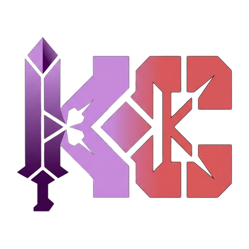
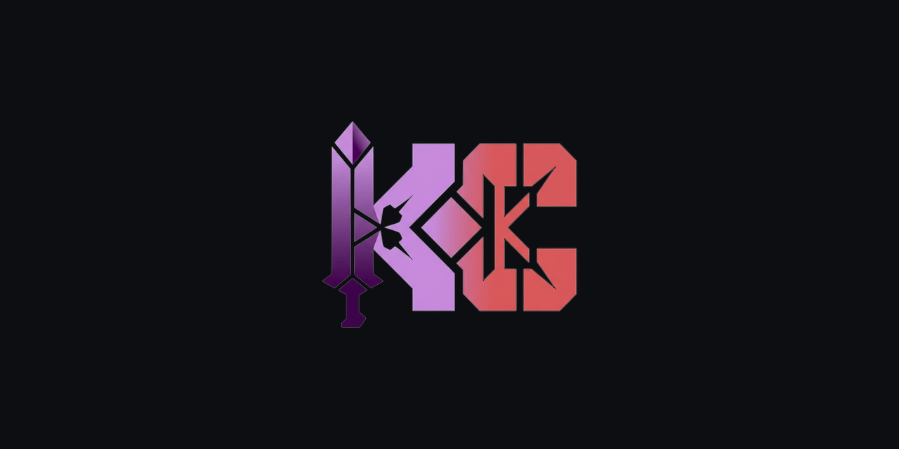

<!-- kapsca-brand v1 (vendored copy of KapsCa/kapsca-brand; do not edit manually) -->

<picture>
  <source media="(prefers-color-scheme: dark)" srcset="assets/brand/kapsca-512.png">
  <source media="(prefers-color-scheme: light)" srcset="assets/brand/kapsca-mono-white.svg">
  
</picture>

<!-- /kapsca-brand -->

  <h1>Built with AI Studio</h2>

  
The fastest path from prompt to production with Gemini.

  <a href="https://aistudio.google.com/apps">Start building</a>

